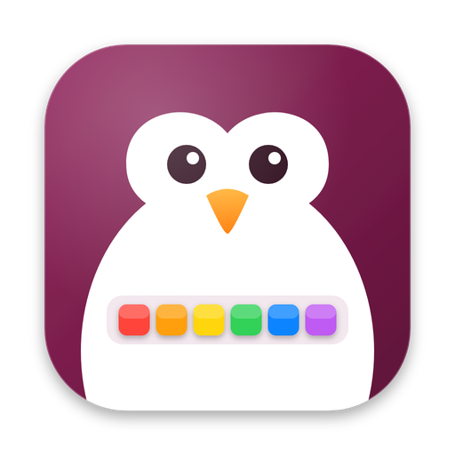
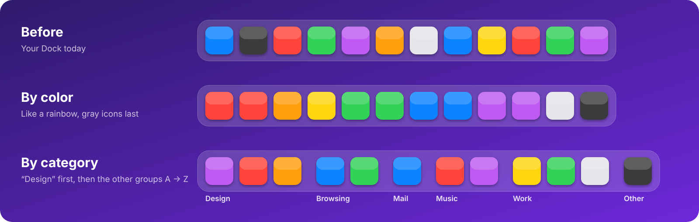

  

<h1 align="center">Ordock</h1>

<b>Put your Mac's Dock in order, in one click.</b> 
Sort your Dock apps by name, color, last use or category, from the menu bar.

  

Free · Open source · macOS 13 Ventura or later (Apple Silicon &amp; Intel) · English &amp; Italiano · <a href="../../releases">All versions</a>

  <a href="README.md">🇬🇧 English</a> · <a href="README.it.md">🇮🇹 Italiano</a>

  

---

## The problem

Apps pile up in the Dock in the order you happened to add them. After a while, finding the right icon
means scanning the whole row every time, and dragging icons around one by one to tidy up is tedious.

## The fix

Ordock lives in the menu bar and rearranges the apps in your Dock for you: alphabetically, like a rainbow,
by how recently you used them, or grouped by what they do. If you don't like the result, one click
brings back your original order.

## Features

- **Sort by name:** A → Z, in one click
- **Sort by color:** reads each icon and lines them up like a rainbow (reds → oranges → yellows →
  greens → blues → purples), with gray, white and black icons at the end
- **Sort by last used:** the apps you used most recently go first, on the **left** or on the **right**
  of the Dock, your choice
- **Sort by category:** groups your apps (Browsing, Mail, Socials, Design, Video, Music & audio, Work,
  Development, Utilities, Fun, System, Other) with a small space between groups
  - click a category to put it **first**, at the left of the Dock: the other groups follow
  - common apps are recognized automatically; move any app to another group, create your own groups
  - groups in **alphabetical** order, or drag them into your own order
- **Saved orders:** save your Dock as "Work" or "Weekend" and bring it back with one click
- **Dock clean-up:** finds the apps you haven't opened in 1, 3, 6 or 12 months (and apps that were
  deleted from the Mac) and lets you choose which to remove from the Dock
- **Keyboard shortcut:** **⌃⌥⌘ O** repeats your last sort, from any app (or ⌃⌥⌘ D / R, or off)
- **Settings window** with every option in one place
- **Welcome guide:** a short animated tour on first launch (reopen it anytime from the menu)
- **English and Italian:** choose in the welcome guide, switch anytime from the menu
- **Safe by design:**
  - your original Dock order is saved the first time you sort, and **Restore** brings it back
  - if the backup can't be saved, the Dock is not touched
  - restoring never removes apps you added later: they go to the end
  - clean-up saves the current order first, so you can undo it from **Saved orders**
  - apps are never deleted from your Mac: they only leave the Dock
- **Native and light:** written in Swift, no internet connection, no account, no data collected

## Download and install

1. Download **[Ordock.dmg](../../releases/latest/download/Ordock.dmg)** and open it.
2. Drag **Ordock** onto the **Applications** folder, right there in the window.
3. The first time, **right-click Ordock in Applications → Open**, then confirm.
   On recent macOS versions you may need **System Settings → Privacy & Security → Open Anyway**.
4. A short **welcome guide** shows you around. Then look for the **penguin in the menu bar**, at the top right next to the clock.

Prefer a zip? **[Ordock.zip](../../releases/latest/download/Ordock.zip)** works too: unzip it and drag **Ordock.app** into Applications.

> **Why the warning?** Ordock is not notarized by Apple (that requires a paid developer account),
> so macOS asks you to confirm the first time. The full source code is right here in this repository.

## Quick start

1. Click the Ordock icon in the menu bar.
2. Choose **Sort by name**, **Sort by color**, **Sort by last used** or **Sort by category**.
3. The Dock disappears and reappears for a second (that's how macOS reloads it) and your apps are in order.
4. Changed your mind? **Restore original order**.

## Guide

### The menu

| Menu item | What it does |
|---|---|
| **Sort by name (A → Z)** | Alphabetical order |
| **Sort by color** | Rainbow order, neutral icons last |
| **Sort by last used ›** | *Most recent on the left* or *Most recent on the right* |
| **Sort by category › Put first in the Dock** | Click a category: its apps go first, the other groups follow |
| **Sort by category › All in order, none first** | All groups in their order, no favorite |
| **Sort by category › Change an app's category** | Pick an app, then its new group |
| **Saved orders ›** | Apply, save or delete a named Dock layout |
| **Clean up Dock ›** | Find apps unused for 1, 3, 6 or 12 months |
| **Restore original order** | Puts the Dock back the way it was before your first sort |
| **Save current order as original…** | Makes today's Dock the new "original" |
| **Settings… (⌘ ,)** | Opens the settings window |
| **Language ›** | Automatic, Italiano or English |
| **Shortcut ›** | ⌃⌥⌘ O, D or R, or none |

### The settings window

- **General:** language, open at login, keyboard shortcut
- **Sort:** one button for each way of sorting
- **Categories:** on the left your groups with how many apps each one has (drag to reorder, **+** / **−**
  to add or remove your own); on the right the apps of the selected group, with **Move to** and
  **Add an app to this group**. Choose **Alphabetical** or **Custom** group order and whether to
  leave spaces between groups
- **Saved orders:** save, apply and delete your layouts
- **Clean-up & restore:** Dock clean-up, restore the original order, open the backup folder

### How "last used" works

Ordock combines two sources: the date macOS records each time an app is opened, and its own note of
every time you switch to an app while Ordock is running. The longer Ordock runs, the more accurate it gets.
Apps never opened go to the end.

## Examples

**"I always look for my design apps first."**
Sort by category › Put first: **Design**. Photoshop, Illustrator, Figma… sit at the left of the Dock,
then Browsing, Mail, Music and the rest, each group separated by a small space.

**"I want the apps I use right now close to the Finder."**
Sort by last used › **Most recent on the left**. Press **⌃⌥⌘ O** whenever you want to refresh it.

**"My Dock should match my mood."**
Sort by color for a rainbow Dock. Save it as **"Rainbow"** in Saved orders, then switch back to your
**"Work"** layout with one click.

**"My Dock is full of apps I never open."**
Clean up Dock › **6 months**. Tick the apps you don't need and click **Remove from Dock**.
The previous layout is saved as *"Before clean-up"*, just in case.

**"I added a work app and it landed in Other."**
Sort by category › Change an app's category › pick the app › **Work**. Ordock remembers it.

## FAQ

**Does Ordock delete apps?** No. It only changes the order of the icons in the Dock. Clean-up removes
icons from the Dock, never the apps from your Mac.

**What gets sorted?** The apps pinned on the left side of the Dock. Folders, Downloads, the Trash and
recent apps stay where they are.

**Sort by color puts everything together?** With the *Tinted* or *Clear* icon styles of
System Settings → Appearance all icons share one color: use the *Default* style for the best result.

**Where are the backups?** In `~/Library/Application Support/Ordock/`
(Settings → Clean-up & restore → *Open the backup folder*).

**I used "Riordina Dock" before.** That was Ordock's previous name. The installer removes the old app
and Ordock picks up its backups automatically.

## Build from source

Requires **Xcode** (or the Command Line Tools) and macOS 13 or later.

1. Download this repository (**Code → Download ZIP**) and unzip it.
2. Open **Terminal**, type `bash ` (with a space), drag in **Install Ordock.command** and press **Return**.
3. Choose the language: the app is built, copied to Applications and opened.

Every push to `main` builds the app automatically (see the **Actions** tab), and every new version is
published under **[Releases](../../releases)** with `Ordock.dmg` and `Ordock.zip` attached.

## Support

Ordock is free. If it makes your day a little tidier, you can buy me a coffee:
**[paypal.me/mattdanieli](https://paypal.me/mattdanieli)** ❤️

More apps: **[mattdanieli.it/apps](https://www.mattdanieli.it/apps/)**

## License

[MIT](LICENSE)

Made With Love ❤️ by MattDanieli

