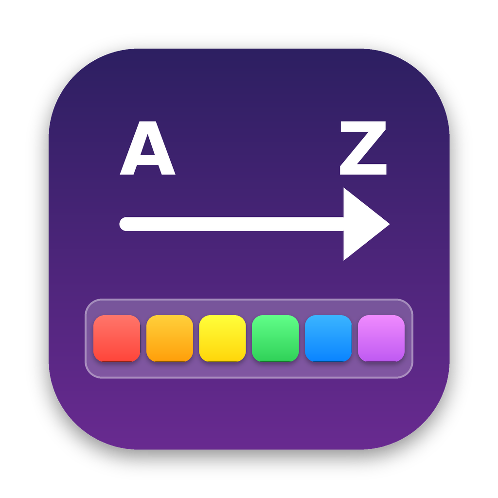

  

<h1 align="center">Riordina Dock</h1>

  <a href="#-italiano">🇮🇹 Italiano</a> · <a href="#-english">🇬🇧 English</a>

---

## 🇮🇹 Italiano

Ordina le app del Dock del Mac **per nome** o **per colore**, con un clic. E se non ti piace il risultato, torni all'ordine originale.

### ✨ Cosa fa

| Funzione | Descrizione |
|---|---|
| 🔤 **Ordina per nome** | Mette le app in ordine alfabetico (A → Z) |
| 🌈 **Ordina per colore** | Analizza le icone e le dispone come un arcobaleno: rossi → arancioni → gialli → verdi → blu → viola. Le icone grigie, bianche e nere vanno in fondo |
| ↩️ **Ripristina ordine originale** | La prima volta che ordini, l'app salva com'era il Dock. Un clic e torna tutto come prima |
| 💾 **Salva ordine attuale** | Imposta l'ordine di adesso come nuovo "originale" |
| 🚀 **Apri all'avvio** | Si avvia da sola quando accendi il Mac |

Vive nella **barra dei menu**, in alto vicino all'orologio. L'interfaccia è in italiano o in inglese in base alla lingua del Mac.

### 📥 Scarica l'app pronta

Vai su **[Releases](../../releases/latest)**, scarica `RiordinaDock.zip` e trascina l'app in **Applicazioni**.

Al primo avvio macOS potrebbe bloccarla perché non è firmata da uno sviluppatore registrato: vai in **Impostazioni di Sistema → Privacy e sicurezza** e clicca **Apri comunque**.

### 🛠️ Compilare dal codice

Serve **Xcode** e macOS 13 o successivo.

1. Scarica il progetto (**Code → Download ZIP**) ed estrailo
2. Apri **Terminale**, scrivi `bash ` (con uno spazio), trascina dentro `Installa Riordina Dock.command` e premi **Invio**

### 🛡️ Sicurezza e note

- Non serve disattivare nessuna protezione di macOS
- Se non riesce a salvare la copia di sicurezza, **non modifica il Dock**
- Il ripristino non toglie mai app: quelle aggiunte dopo finiscono in fondo
- Copia di emergenza in `~/Library/Application Support/Riordina Dock/`
- Quando riordini, il Dock sparisce e riappare per un secondo: è normale
- Vengono ordinate solo le app fisse (parte sinistra del Dock)
- L'ordine per colore funziona meglio con lo stile icone **Predefinito** (Impostazioni di Sistema → Aspetto)

---

## 🇬🇧 English

Sort your Mac's Dock apps **by name** or **by color** in one click. Don't like the result? Restore the original order.

### ✨ Features

| Feature | Description |
|---|---|
| 🔤 **Sort by name** | Puts apps in alphabetical order (A → Z) |
| 🌈 **Sort by color** | Analyzes each icon and arranges them like a rainbow: reds → oranges → yellows → greens → blues → purples. Gray, white and black icons go last |
| ↩️ **Restore original order** | The first time you sort, the app saves your Dock's order. One click brings it back |
| 💾 **Save current order** | Sets the current order as the new "original" |
| 🚀 **Open at login** | Starts automatically when you turn on your Mac |

It lives in the **menu bar**, next to the clock. The interface is in English or Italian depending on your Mac's language.

### 📥 Download the ready-made app

Go to **[Releases](../../releases/latest)**, download `RiordinaDock.zip` and drag the app into **Applications**.

On first launch macOS may block it because it isn't signed by a registered developer: open **System Settings → Privacy & Security** and click **Open Anyway**.

### 🛠️ Build from source

Requires **Xcode** and macOS 13 or later.

1. Download the project (**Code → Download ZIP**) and unzip it
2. Open **Terminal**, type `bash ` (with a space), drag in `Installa Riordina Dock.command` and press **Return**

### 🛡️ Safety and notes

- No macOS security features need to be disabled
- If the backup can't be saved, **the Dock is not changed**
- Restoring never removes apps: apps added later go to the end
- Emergency copy in `~/Library/Application Support/Riordina Dock/`
- The Dock disappears and reappears for a second when sorting: that's normal
- Only pinned apps are sorted (left side of the Dock)
- Color sorting works best with the **Default** icon style (System Settings → Appearance)

---

## 📄 Licenza / License

[MIT](LICENSE)
